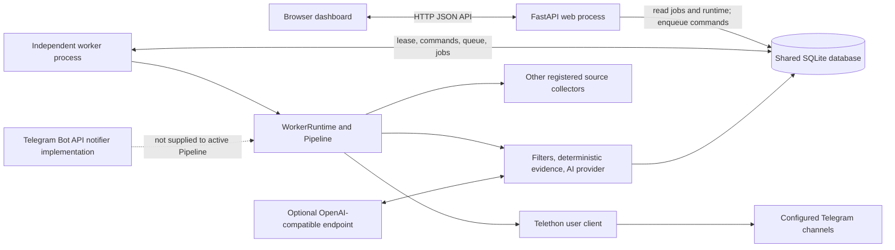
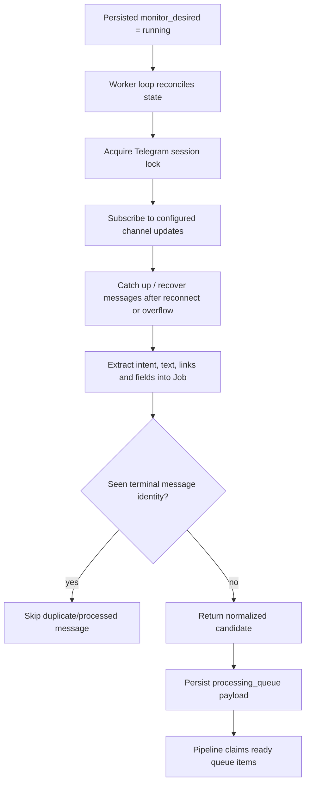
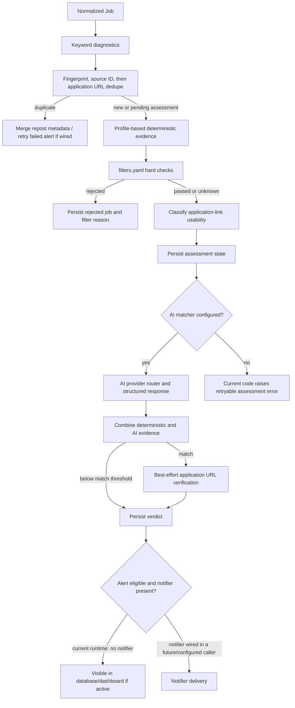
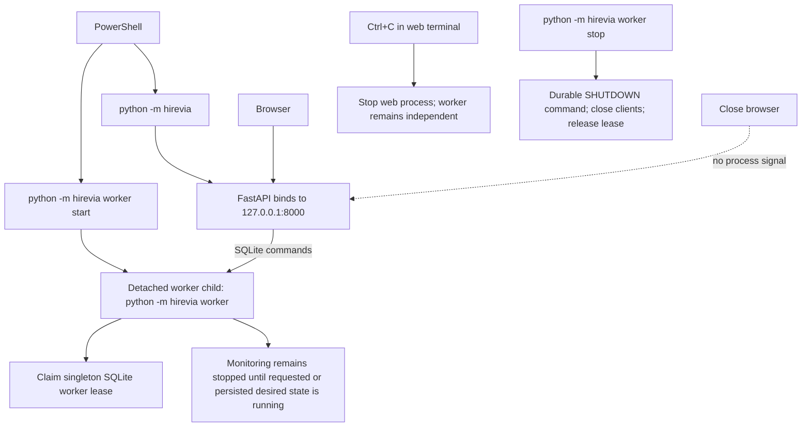
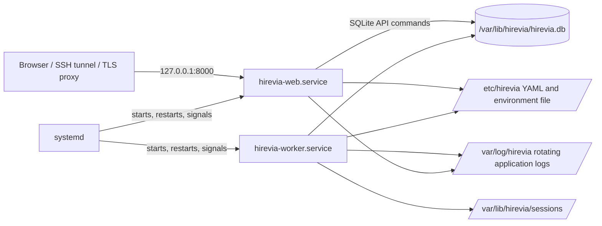

# Hirevia Project Guide

This guide describes the implementation in this checkout, not just the older project overview. **Verified** means supported by the current code or the supplied service files. **Recommendation** means an operational practice or setup adjustment, not something the application performs automatically. No secret values are included here.

## What Hirevia Runs

Hirevia is a Python application with a FastAPI dashboard and a separately managed worker. The worker owns monitoring, Telegram collection, the processing pipeline, and durable queue work. The dashboard serves static files and API routes, and passes worker commands through SQLite. Closing the browser does not stop either process.

The primary path is:

`Telegram channels -> Telethon collector -> normalized job candidates -> SQLite processing queue -> filters and matching -> jobs table -> dashboard`

The current runtime does **not** send job alerts: the Bot API notifier classes exist, but the web/worker pipeline is constructed with `notifier=None`. AI matching is used only when a provider is configured; the current no-provider path has a retry behavior described under [Known Issues & Risks](#known-issues--risks).

## Architecture

### Overall System



The Telegram **user client** reads public channels using MTProto. It is separate from the Bot API notification classes. The worker is the normal owner of the Telethon client and uses a cross-process lock next to the session file.

### Discovery and Collection



Non-Telegram sources use the same registry and pipeline, but their collected jobs are processed directly rather than passed through the Telegram message queue. Telegram's first visit uses its configured lookback; subsequent reads use persisted per-channel message cursors. Continuous mode also listens for new events and retries incomplete events.

### Job Processing



Actual processing includes expiry first, source collection, sorting by freshness, Telegram queueing/claiming, per-job filtering and matching, link checks for matches, persistence, and finally an alert eligibility check. The no-notifier branch is the one used by the active web/worker implementation.

### Database and Job Lifecycle

```mermaid
stateDiagram-v2
    [*] --> Discovered: Telegram message / source result
    Discovered --> Queued: processing_queue insert
    Queued --> Processing: atomic worker claim
    Processing --> Processed: job handled successfully; queue row removed
    Processing --> Queued: retryable failure / worker recovery
    Processing --> Failed: assessment attempts exhausted
    Queued --> Expired: queued item older than 24 hours
    Discovered --> Processed: Telegram message was not a job
    Processed --> JobRow: accepted or hard-filtered candidate persisted
    JobRow --> Updated: repost/upsert refreshes last_seen and fields
    JobRow --> PhysicallyDeleted: expiration or dashboard delete
    JobRow --> PhysicallyDeleted: dashboard Delete All
```



`jobs.application_status` is `open`, `closed`, `expired`, or `unknown`; matching assessment status is stored in `match_result`/`raw_data` and is a different concept. Automatic job expiry and dashboard delete operations physically remove rows. `deleted_at` exists in the schema but the current delete method does not set it.

### Local Startup and Shutdown



`python -m hirevia` with no subcommand starts the web server only. It does not spawn the worker. Start the worker explicitly. A dashboard Start/Stop action controls monitoring inside an already-running worker; it does not start or stop the worker process itself.

### VPS Services



The supplied web unit orders itself after and wants the worker unit. Both use `Restart=always`; an explicit `systemctl stop` remains stopped, while an unexpected exit is restarted. The worker's persisted monitor desired state survives a service restart/reboot.

## Project Map

- `hirevia/__main__.py` calls the Click CLI; `python -m hirevia` is the primary entry point. The root `hirevia.py` file is empty in this checkout.
- `hirevia/cli.py` defines web, worker, doctor, legacy scan/monitor commands, statistics, Telegram login, and AI provider commands.
- `hirevia/config.py` loads `.env` from the current working directory and `sources.yaml`, `filters.yaml`, and optional `ai.yaml` from that directory.
- `hirevia/web/main.py` creates the FastAPI app, static dashboard routes, `/health`, and optional bearer-token middleware. `hirevia/web/api/routes.py` exposes dashboard actions and settings. `hirevia/web/state.py` adapts API requests to the shared repository and worker. Browser assets are in `hirevia/web/static/`.
- `hirevia/worker.py` owns the OS worker loop, durable lease, command handling, Telegram session ownership, and graceful cleanup. `hirevia/worker_process.py` spawns/reaps locally managed workers and communicates through database commands. `hirevia/worker_runtime.py` owns the pipeline instance and monitor task.
- `hirevia/core/pipeline.py` orchestrates collection through storage. `models.py`, `dedup.py`, `filtering.py`, `freshness.py`, `matching.py`, `keyword_matching.py`, `classification.py`, `verification.py`, and `skills.py` provide data types and processing logic. `core/bkp*` files are backups, not imported active pipeline modules.
- `hirevia/sources/registry.py` dynamically loads enabled sources. Implemented source modules in this checkout: Telegram, Greenhouse, Lever, Ashby, and Wellfound. Wellfound currently returns no jobs (placeholder). Other names in `sources.yaml`/the registry do not have source modules here and are not implemented collectors.
- `hirevia/sources/telegram_source.py`, `telegram_extract.py`, `telegram_config.py`, and `telegram_session_lock.py` implement read-only Telegram collection, message-to-job parsing, settings, and exclusive session ownership.
- `hirevia/profile/profile.py` loads the candidate profile; `hirevia/ai/` builds the OpenAI-compatible provider router and matcher.
- `hirevia/storage/state.py` owns SQLite schema, migrations, repository operations, leases, commands, message history, and the processing queue.
- `hirevia/notifications/telegram.py` contains Bot API notification classes, but they are not connected to the active web/worker pipeline.
- `deploy/hirevia-web.service` and `deploy/hirevia-worker.service` are the supplied systemd units. `docs/VPS.md` and `README.md` provide earlier quick-start material; this guide records implementation differences found during inspection.
- `tests/` contains tests for matching, storage, sources, worker process management, web state, Telegram, and configuration. `requirements.txt` is the dependency list. There is no `pyproject.toml`, `setup.py`, or `setup.cfg` in this checkout.

## Local Windows Guide

### Prerequisites and install

**Verified:** the code uses Python 3.10+ syntax. Python 3.10 or newer, PowerShell, network access, and a local SQLite-capable filesystem are required. SQLite is provided by Python; no separate database server is used.

From the project root:

```powershell
Set-Location "C:\path\to\Hirevia"
py -3 --version
py -3 -m venv .venv
.\.venv\Scripts\python.exe -m pip install -r requirements.txt
```

The virtual environment isolates Hirevia's packages. You may activate it with `\.venv\Scripts\Activate.ps1`, or keep using the explicit `.venv` Python path shown below. No editable install is needed for local use from the repository root.

### Configuration and secrets

Configuration is read relative to the process working directory. Open `.env` in an editor and set only the values needed for your setup. `python-dotenv` loads the project-root `.env` without overriding variables already set in the process environment. Never paste credential values into documentation, support logs, or Git.

Important environment variable names:

- Telegram user session: `TELEGRAM_API_ID`, `TELEGRAM_API_HASH`; optional `TELEGRAM_SESSION_NAME`, `TELEGRAM_SESSION_DIR`.
- AI: `AI_PRIMARY_PROVIDER`, `AI_FALLBACK_PROVIDERS`, `AI_TIMEOUT_SECONDS`, plus provider-specific `NVIDIA_API_KEY`, `NVIDIA_MODEL`, `NVIDIA_BASE_URL`; `GROQ_API_KEY`, `GROQ_MODEL`, `GROQ_BASE_URL`; `OLLAMA_MODEL`, `OLLAMA_BASE_URL`; `LLAMACPP_MODEL`, `LLAMACPP_BASE_URL`. Local endpoints may use the API-key setting defined for that provider if configured.
- Paths and web: `HIREVIA_DB_PATH`, `HIREVIA_AUTH_DB_PATH`, `PROFILE_PATH`, `HIREVIA_HOST`, `HIREVIA_PORT`, `HIREVIA_ADMIN_EMAIL`, `HIREVIA_ADMIN_PASSWORD`, `HIREVIA_SESSION_SECRET`, `HIREVIA_SESSION_TTL_SECONDS`, `HIREVIA_ENV`, `HIREVIA_COOKIE_SECURE`, `HIREVIA_ALLOWED_HOSTS`, `HIREVIA_LOG_DIR`, `HIREVIA_LOG_LEVEL`, `HIREVIA_LOG_MAX_BYTES`, `HIREVIA_LOG_BACKUPS`, `HIREVIA_WORKER_MODE`, `HIREVIA_WORKER_MANAGED`.
- Matching/verification: `MATCHING_P1_THRESHOLD`, `MATCHING_P2_THRESHOLD`, `MATCHING_P3_THRESHOLD`, `VERIFY_APPLICATION_URLS`, `VERIFY_TIMEOUT_SECONDS`, `NOTIFY_MIN_MATCH_SCORE`, `NOTIFY_MAX_AGE_HOURS`, `SCAN_INTERVAL_MINUTES`.

Not every variable needs to be set. The checked-in `ai.yaml.example` selects `llamacpp` but leaves its model blank, so AI is not configured until you set a model/provider endpoint. The application does not launch llama.cpp, Ollama, or a hosted provider for you.

The current project already has `filters.yaml`, `sources.yaml`, `profile.yaml`, and `telegram.yaml`. If setting up a fresh copy and one of these is absent, use its `.example` template where available; for example:

```powershell
if (!(Test-Path .\profile.yaml)) { Copy-Item .\profile.yaml.example .\profile.yaml }
if (!(Test-Path .\telegram.yaml)) { Copy-Item .\telegram.yaml.example .\telegram.yaml }
if (!(Test-Path .\ai.yaml) -and (Test-Path .\ai.yaml.example)) { Copy-Item .\ai.yaml.example .\ai.yaml }
```

Edit `profile.yaml` to personalize match relevance; `filters.yaml` is a hard-filter layer, not a substitute for the profile. `sources.yaml` enables/disables collectors. `telegram.yaml` lists channel usernames and options (`enabled`, first-visit `lookback_hours`, and per-scan `max_messages`).

### Telegram authentication and sessions

The collector uses a Telethon **user account**, not a bot token. Create Telegram API credentials through Telegram's developer site and put the values only in `.env` or a protected environment. Then authenticate once:

```powershell
.\.venv\Scripts\python.exe -m hirevia telegram-login
```

The command prompts for the phone number, one-time code, and (if enabled) 2FA password. It creates a local `.session` file and an adjacent Hirevia lock file. Keep the session private and do not delete or copy it while a process is using it.

For CLI login, authenticate before starting the background worker. If the worker is already active, stop it first with `worker stop`. Alternatively, start the web UI and worker, then use the dashboard login flow; the API asks the worker to release and reacquire the Telethon session during authentication. This handoff allows the monitor to resume when it had been running.

### Start, monitor, verify, stop

In a PowerShell window at the repository root, start the worker:

```powershell
.\.venv\Scripts\python.exe -m hirevia worker start
.\.venv\Scripts\python.exe -m hirevia worker status
```

`worker start` launches one detached worker and waits for its SQLite lease. Monitoring starts only when requested in the dashboard or when the database already records desired monitoring as `running`. `worker status` displays the process/monitor status; like repository-backed CLI commands, it initializes a missing database.

In a second window, start the web/API process:

```powershell
.\.venv\Scripts\python.exe -m hirevia
```

Open `http://127.0.0.1:8000`. The web process serves the dashboard and API; use the dashboard's Telegram login/validation and Start Monitor controls. Default binding is loopback-only. The first web startup creates an admin from `HIREVIA_ADMIN_EMAIL` and `HIREVIA_ADMIN_PASSWORD` if the auth database has none, then removes the one-time plaintext password from the env file. Existing admin credentials are never overwritten by restart or environment changes. See [AUTHENTICATION.md](AUTHENTICATION.md) for the exact bootstrap, session security, and deployment steps. Remote use should remain behind HTTPS on a TLS reverse proxy or SSH tunnel.

To verify without starting or changing a service, use:

```powershell
.\.venv\Scripts\python.exe -m hirevia doctor
.\.venv\Scripts\python.exe -m hirevia stats
.\.venv\Scripts\python.exe -m hirevia sources
```

`doctor` checks the database read-only, reports its integrity and worker lease, and probes the configured API port. `stats` reports stored counts. `sources` reports configured source flags, not whether a source module successfully collected data. In the dashboard, inspect `/api/status`, `/api/queue/status`, source status, and recent activity. Application logs are under `logs\hirevia.log` by default, with rotated `hirevia.log.1`, etc.

To stop only collection but leave web/API available, use the dashboard's Stop Monitor control. To stop the entire worker, use:

```powershell
.\.venv\Scripts\python.exe -m hirevia worker stop
```

To restart the worker gracefully:

```powershell
.\.venv\Scripts\python.exe -m hirevia worker restart
```

To stop the web process, press Ctrl+C in its own terminal. That does not stop the detached worker. Close browser tabs freely; closing the web terminal stops the web/API process, not the detached worker. The `worker stop` command shuts down the worker but does not clear the persisted desired-monitor flag; use Stop Monitor first if you do not want monitoring to resume when the worker next starts.

### Other CLI modes

- `python -m hirevia scan` performs one foreground scan.
- `python -m hirevia monitor` runs the older foreground Telegram event monitor.
- `python -m hirevia start` runs the older continuous scan loop.
- `python -m hirevia ai status`, `ai test`, and `ai set-primary PROVIDER` inspect/test/configure providers. `ai test` contacts the provider.
- `python -m hirevia status` lists recent stored jobs; `stats` summarizes; `doctor` is the read-only diagnostic.

These direct scan/monitor commands are not the independent worker service and do not use its worker lease/session ownership lifecycle. Do not run them concurrently with the managed worker against the same Telegram session/database.

## Ubuntu VPS Guide

### What the supplied units expect

**Verified from the service files:** application code and virtual environment at `/opt/hirevia`; YAML/environment at `/etc/hirevia`; persistent database/session data at `/var/lib/hirevia`; rotating application logs at `/var/log/hirevia`. The web service binds to `127.0.0.1:8000`. The worker and web unit set `HIREVIA_WORKER_MANAGED=1`, so the web process will not spawn another worker.

**Important setup caveat:** both units run with `WorkingDirectory=/etc/hirevia` but execute Python from `/opt/hirevia/.venv`. This checkout has no Python packaging metadata, so the older `pip install -e /opt/hirevia` instruction in `docs/VPS.md` cannot work as written. In a clean venv, Python also does not automatically search `/opt/hirevia` when the working directory is `/etc/hirevia`. Do not assume those commands work unchanged.

**Recommendation to preserve the supplied layout:** put `PYTHONPATH=/opt/hirevia` in `/etc/hirevia/hirevia.env` (which both units load), and ensure all non-secret YAML files are in `/etc/hirevia`. This makes the package importable while keeping configuration lookup in `/etc/hirevia`. Alternatively, add valid packaging metadata and install the project properly, or change the unit layout deliberately. Verify import before enabling services:

```bash
sudo -u hirevia env PYTHONPATH=/opt/hirevia /opt/hirevia/.venv/bin/python -c 'import hirevia; print(hirevia.__file__)'
```

That is a diagnostic/recommended import check, not a command defined by Hirevia.

### Install and configure

**Recommendation:** deploy the repository at `/opt/hirevia` (the unit paths assume it), create a dedicated `hirevia` system user, and ensure it owns or can read the code and write only the configured data/config/log paths. Provision Python 3.10+, Git, and venv support; ensure outbound network access for Telegram and any AI endpoint. Exact account and clone steps depend on your VPS and repository URL.

Create the required directories and virtual environment, then install declared dependencies:

```bash
sudo install -d -o hirevia -g hirevia -m 0700 /etc/hirevia /var/lib/hirevia /var/lib/hirevia/sessions /var/log/hirevia
sudo -u hirevia python3 -m venv /opt/hirevia/.venv
sudo -u hirevia /opt/hirevia/.venv/bin/pip install -r /opt/hirevia/requirements.txt
```

Copy the non-secret YAML configuration into `/etc/hirevia`: `sources.yaml`, `filters.yaml`, `profile.yaml`, `telegram.yaml`, and `ai.yaml` if used. These paths are resolved from the systemd working directory. `PROFILE_PATH` may point to a different profile file. Use your own config values; do not put credentials in YAML.

Create `/etc/hirevia/hirevia.env` with `PYTHONPATH=/opt/hirevia`, Telegram API credentials, `TELEGRAM_SESSION_DIR=/var/lib/hirevia/sessions`, `HIREVIA_ADMIN_EMAIL`, one-time `HIREVIA_ADMIN_PASSWORD`, `HIREVIA_AUTH_DB_PATH=/var/lib/hirevia/auth.db`, `HIREVIA_SESSION_SECRET`, `HIREVIA_ENV=production`, `HIREVIA_COOKIE_SECURE=true`, and the public hostname in `HIREVIA_ALLOWED_HOSTS`; add the chosen AI provider settings as needed. The supplied systemd units load this file and the first web startup consumes the bootstrap password. Restrict it:

```bash
sudo chown hirevia:hirevia /etc/hirevia/hirevia.env
sudo chmod 600 /etc/hirevia/hirevia.env
```

The service units set `HIREVIA_DB_PATH=/var/lib/hirevia/hirevia.db`, `HIREVIA_LOG_DIR=/var/log/hirevia`, and session directory themselves. The database and session persist independently of the code checkout. Keep Telegram session files private.

### Install and manage systemd services

The unit source files are in `deploy/`. These commands install the supplied definitions; the service definitions themselves were verified, but successful startup depends on resolving the `PYTHONPATH`/packaging caveat above and having valid environment/configuration:

```bash
sudo install -o root -g root -m 644 /opt/hirevia/deploy/hirevia-worker.service /etc/systemd/system/hirevia-worker.service
sudo install -o root -g root -m 644 /opt/hirevia/deploy/hirevia-web.service /etc/systemd/system/hirevia-web.service
sudo systemctl daemon-reload
sudo systemctl enable --now hirevia-worker.service
sudo systemctl enable --now hirevia-web.service
sudo systemctl status hirevia-worker.service hirevia-web.service
```

On a new install the monitor's desired state defaults to stopped. Authenticate Telegram, validate channels, then use Start Monitor in the dashboard. Reach the loopback dashboard through SSH:

```bash
ssh -L 8000:127.0.0.1:8000 user@YOUR_VPS_HOST
```

Then browse to `http://127.0.0.1:8000`. Do not expose port 8000 directly to the public internet. A public endpoint needs HTTPS through a TLS reverse proxy, secure session cookies, and a trusted-host entry.

Useful service commands:

```bash
sudo systemctl restart hirevia-web.service
sudo systemctl restart hirevia-worker.service
sudo systemctl stop hirevia-web.service
sudo systemctl stop hirevia-worker.service
sudo systemctl start hirevia-worker.service
sudo systemctl status hirevia-worker.service hirevia-web.service
sudo journalctl -u hirevia-worker.service -n 100 --no-pager
sudo journalctl -u hirevia-web.service -n 100 --no-pager
```

Stopping the worker unit stops the worker process, not just monitoring. It does not clear `monitor_desired`; if it was `running`, a later worker start or reboot may resume monitoring. Use Stop Monitor in the dashboard first when the intended state should remain stopped. Stopping/restarting the web unit alone leaves the worker running.

`Restart=always` and restart delays are set in each unit. `systemctl enable` configures reboot startup. An explicit systemd stop is not restarted automatically by the unit policy. On reboot, the worker reads the shared database and restores monitoring only if `monitor_desired=running`; Telegram session/config must still be usable.

### Logs, updates, backup, and recovery

Systemd's journal records console output; complete rotating application logs are under `/var/log/hirevia`. Check both. Before updates, inspect `git status`, stop monitoring if desired, and make a verified database backup. Preserve `/etc/hirevia`, `/var/lib/hirevia`, and `/var/log/hirevia` when replacing code.

**Recommendation:** update the checkout with `git pull --ff-only` only after resolving local changes. If requirements change, reinstall with `pip install -r`; do not use `pip install -e` until the project has packaging metadata. If either unit file changes, reinstall it and run `systemctl daemon-reload`. Restart worker and web after code/config updates. A normal worker restart is graceful and retains the desired-monitor flag.

For a consistent backup while SQLite is active, use SQLite's online backup API/CLI, not a raw copy of the live database or its WAL sidecars. See [Database safety](#database-and-data-safety). Restore only after stopping both services, retaining a separate copy of the current database, and verifying the backup with `PRAGMA quick_check` before replacing the live database.

## Process Management: Exact Answers

- **Does closing the dashboard stop monitoring?** No. A browser is only an HTTP client; it sends no shutdown signal on tab close.
- **Does stopping the web server stop monitoring?** No in the normal CLI/systemd architecture. `external_worker=True` makes FastAPI explicitly avoid starting/stopping an external worker. The worker continues independently.
- **Does `python -m hirevia` start one or multiple services?** One: the web/API process. It does not auto-start monitoring or spawn a worker. Start a worker with `python -m hirevia worker start` locally or systemd on the VPS.
- **Can monitoring run without the dashboard?** Yes, if the worker exists, Telegram is configured/authenticated, and desired monitoring is running. The dashboard is not required for the worker loop.
- **Can the dashboard run without the worker?** Yes, but it cannot perform worker-backed monitor/scan/auth commands. It can serve static UI and status/API reads; worker-dependent actions fail or show an unavailable state.
- **Can duplicate workers exist?** The worker claims a singleton PID lease in its database; simultaneous workers sharing the same database should not both own it. Telegram session locking further restricts use of the same session file. Separate database paths have separate leases. Legacy `start`, `scan`, and `monitor` commands bypass the worker service lease, so do not run them alongside it.
- **Can two workers process the same Telegram queue item?** Queue claims are performed under an immediate SQLite transaction and update only `QUEUED` rows. The worker lease is the first singleton guard; the queue claim is an additional guard.
- **What does Ctrl+C do?** In the web terminal it stops Uvicorn/FastAPI and its web lifespan; it does not send SHUTDOWN to an external worker. In a foreground worker or legacy monitor, the worker handles SIGINT and runs cleanup. In an OS-managed background worker, use `worker stop` or `systemctl stop` instead of closing the launching shell.
- **What if a terminal closes?** `worker start` creates a detached process (`DETACHED_PROCESS` on Windows, new session on POSIX), with standard streams redirected away from the terminal. It normally survives closing the launcher terminal. A foreground `worker`/`monitor` or the web process is tied to its terminal/session and may stop when that terminal is terminated.
- **What happens on VPS reboot?** Enabled systemd services start again. The worker claims a new lease and reconciles persisted desired monitor state. A previously running monitor resumes; a manually stopped one remains stopped. No jobs database or session should live only in the code checkout.
- **How are background processes tracked?** `worker_runtime` stores PID, worker/monitor states, heartbeat, start time, errors, Telegram account/validation summary, and last scan time. `worker_commands` is the durable command mailbox. The PID is checked against the OS; stale leases are reported rather than blindly signaled.
- **Is shutdown graceful?** Yes for the worker's normal path: a durable SHUTDOWN command or SIGINT/SIGTERM sets its stop event, the monitor/listener stops, Telegram clients close, session lock and lease release. The locally spawned process controller has a timeout and may terminate/kill only a child it spawned and verified. A systemd stop has a 45-second timeout in the supplied units; after timeout systemd can force termination.

## Database and Data Safety

### Database location and tables

`HIREVIA_DB_PATH` selects the database. If unset, it is `hirevia.db` in the current working directory. The path is resolved to an absolute path and shared with locally spawned workers. On the VPS the units explicitly use `/var/lib/hirevia/hirevia.db`. SQLite is initialized in WAL mode with a 30-second busy timeout per connection. WAL may create `-wal` and `-shm` sidecars; never remove them manually while the application is active.

| Table | Purpose |
| --- | --- |
| `jobs` | Normalized job fields, source identity, application status, fingerprints, first/last-seen and 24-hour expiry timestamps, saved flag, notification fields, raw JSON, AI decision, and combined match result. |
| `source_state` | Durable key/value state: Telegram per-channel cursors and system values such as desired monitoring and Telegram auth handoff status. |
| `telegram_message_history` | Message identity and discovery/processing status, timestamps, and last error. Retains identity after a queued payload is completed or expires. |
| `processing_queue` | Durable Telegram job payloads, queue state, attempt count, retry time, source time, and error. Successful processing removes the queue row. |
| `worker_runtime` | Singleton worker PID lease, worker and monitor status, heartbeat, start time, last error, and Telegram account/validation summary. |
| `worker_commands` | Durable commands from web/API to worker, with arguments, status, result, and error. |

Schema and additive migrations are created by `JobRepository`. `jobs.updated_at` is maintained by a trigger. No separate queue server is used.

### Inserts, duplicates, status, and deletion

- Jobs are inserted/upserted by `(source, source_job_id)`. Updates preserve ID, `first_seen`, saved state/timestamp, and deletion marker; they refresh mutable fields and `last_seen`.
- Before processing, the pipeline checks a normalized fingerprint, source ID, and (if available) application URL. Reposts merge channel metadata and refresh `last_seen`; duplicate alerts may be retried only if a notifier is supplied.
- Telegram message identity is channel plus message ID. Newly found candidates are serialized into `processing_queue`; claims increment attempts. Success marks history `PROCESSED` and removes the queue row. Failures can be retried with capped exponential delay; exhausted AI assessment attempts become `FAILED`. Old queued items are marked `EXPIRED` and removed after 24 hours.
- `application_status` is separate from the pipeline assessment: available code can store `unknown`, `open`, `closed`, or `expired`. The matcher verifies an application URL best-effort for matched jobs. Dashboard active views show only open/unknown rows that are not expired, and the web query further focuses on the recent 24 hours.
- Job expiry is destructive: `expire_jobs()` issues `DELETE FROM jobs` for rows past `expires_at`. New rows are assigned `saved_at` and `expires_at = saved_at + 24 hours`; the field `saved` is a separate user bookmark flag and does not prevent expiry.
- The dashboard's per-job Delete and Delete All actions physically delete rows. The `soft_delete_job()` method name is misleading; it executes SQL `DELETE`. The `deleted_at` field exists but those operations do not set it. Keep independent backups if you need historical job records.
- Closed/expired jobs are also physically removed by `cleanup_old_jobs(days=30)`, but that cleanup method is not called by the active worker's periodic cleanup. The active worker runs expiry/queue cleanup approximately once per minute and the pipeline also expires jobs at scan start.

### Safe inspection

These examples are read-only. Replace the database path if `HIREVIA_DB_PATH` is set.

PowerShell integrity check:

```powershell
$db = (Join-Path (Get-Location) "hirevia.db")
.\.venv\Scripts\python.exe -c "import sqlite3,sys; from pathlib import Path; p=Path(sys.argv[1]).resolve(); c=sqlite3.connect(p.as_uri()+'?mode=ro',uri=True); print(c.execute('PRAGMA quick_check').fetchone()[0]); c.close()" "$db"
```

PowerShell job counts and queue counts:

```powershell
.\.venv\Scripts\python.exe -c "import sqlite3,sys; from pathlib import Path; p=Path(sys.argv[1]).resolve(); c=sqlite3.connect(p.as_uri()+'?mode=ro',uri=True); print('jobs by status:'); print(*c.execute('SELECT application_status, COUNT(*) FROM jobs GROUP BY application_status'),sep='\n'); print('queue by status:'); print(*c.execute('SELECT status, COUNT(*) FROM processing_queue GROUP BY status'),sep='\n'); c.close()" "$db"
```

Ubuntu read-only inspection with the `sqlite3` command-line program installed:

```bash
sqlite3 -readonly /var/lib/hirevia/hirevia.db "PRAGMA quick_check;"
sqlite3 -readonly /var/lib/hirevia/hirevia.db "SELECT application_status, COUNT(*) FROM jobs GROUP BY application_status;"
sqlite3 -readonly /var/lib/hirevia/hirevia.db "SELECT status, COUNT(*) FROM processing_queue GROUP BY status;"
sqlite3 -readonly /var/lib/hirevia/hirevia.db "SELECT pid, status, monitor_status, heartbeat_at, last_error FROM worker_runtime WHERE singleton=1;"
```

Use only `SELECT` and `PRAGMA` for inspection. Avoid manual `DELETE`/`UPDATE` statements; a seemingly small write can break queue identity/cursors or permanently erase job records.

### Backup and restore

**Recommendation:** use SQLite's online backup API while services are running; it produces a consistent snapshot without manually copying WAL sidecars. If the SQLite shell is available, its `.backup` command is also designed for this:

```bash
sqlite3 /var/lib/hirevia/hirevia.db ".backup '/var/backups/hirevia-YYYYMMDD.db'"
sqlite3 -readonly /var/backups/hirevia-YYYYMMDD.db "PRAGMA quick_check;"
```

For Windows, use Python's standard-library backup API (replace paths as needed):

```powershell
$db = (Join-Path (Get-Location) "hirevia.db")
$backup = (Join-Path (Get-Location) "backups\hirevia-backup.db")
New-Item -ItemType Directory -Force (Split-Path $backup) | Out-Null
.\.venv\Scripts\python.exe -c "import sqlite3,sys; from pathlib import Path; src=sqlite3.connect(Path(sys.argv[1]).resolve().as_uri()+'?mode=ro',uri=True); dst=sqlite3.connect(sys.argv[2]); src.backup(dst); dst.close(); src.close()" "$db" "$backup"
```

For restore, stop the web and worker first, preserve the current database as a separate file, check the chosen backup with `PRAGMA quick_check`, then replace the live database. Do not copy only the main database file while it is active and do not delete `-wal`/`-shm` files by hand. Verify `doctor`, job counts, and dashboard contents before deleting any old backup.

## Configuration Reference

All paths below are relative to the process working directory unless an absolute path or environment override is used. In the supplied VPS units, that working directory is `/etc/hirevia`; locally it should be the project root.

| File/setting | Purpose and important fields | Change/restart behavior | Dashboard/Git guidance |
| --- | --- | --- | --- |
| `sources.yaml` | Enables source names. Only `enabled` is modeled. Telegram is enabled by the sample config; most other names have no module here. | Dashboard save triggers config reload; worker reload rebuilds/restarts an active monitor. Otherwise restart worker. | Editable through dashboard. Commit only if it contains no private deployment preferences; current file is tracked. |
| `filters.yaml` | Hard filters: roles, locations, experience, skills, employment types, excluded keywords. Empty lists generally mean no preference; unknown evidence is treated permissively. | Dashboard save/reload applies to the worker pipeline; direct edits need a worker reload/restart. | Editable through dashboard. Current file is tracked. |
| `profile.yaml` | Candidate matching profile used by deterministic matching and AI prompt. Fields include skills/groups, target experience, roles/families, locations, remote preference, employment types, and optional salary/preferences. Missing profile falls back to a baseline candidate. | Reload/rebuild the worker pipeline to take effect; dashboard config save requests this. | Editable through dashboard. Contains personal data; this checkout currently tracks it. Do not publish personal details; use a sanitized example and ignore/private-store the real profile. |
| `telegram.yaml` | MTProto channel list and enablement; optional per-channel `lookback_hours` and `max_messages`. Does not contain credentials. | Config reload rebuilds an active monitor and revalidates channels. | Editable through dashboard. Public channel names are not authentication secrets, but treat deployment choices as configuration. |
| `ai.yaml` | Optional provider router settings (`enabled`, `primary`, fallbacks/timeouts/retries/cooldown, provider type/base URL/model/key environment-variable name) and score thresholds under `matching`. Current template is `ai.yaml.example`. | Dashboard AI settings also persist selected model/provider/thresholds and optionally a provided key to `.env`, then asks worker to reload. General environment changes require process restart/reload. | YAML files are editable through dashboard; API keys themselves are not returned. Keep `.env` private. |
| `.env` / systemd `hirevia.env` | Secrets and environment overrides: Telegram API credentials, provider API keys, jobs/auth database paths, one-time admin bootstrap credentials, session secret, and optional matching/verification thresholds. Locally `.env` is loaded from CWD; systemd exports `EnvironmentFile` values. | The first web startup consumes the bootstrap password and stores only its Argon2id hash in the auth database. Existing admin credentials are not changed by later environment values. Most other changes require restarting relevant processes. | Never commit. `.env` and `.env.lock` are ignored; `.env.example` is the tracked placeholder template. Protect the VPS environment file with mode `600`. |
| `profile.yaml.example`, `telegram.yaml.example`, `ai.yaml.example` | Safe starting templates (still review before sharing). | Copy/edit before first run; no restart behavior until used. | Templates are tracked. Never place credentials or a real session in them. |
| `deploy/*.service` | systemd service commands, users, directories, environment, restart and security policy. | Changes require reinstalling the unit and `systemctl daemon-reload`, then restarting. | Commit unit definitions; do not commit host-specific secrets/data. |
| `HIREVIA_DB_PATH` | SQLite file path. Default is `hirevia.db` in CWD. | All processes must use the same path; restart processes after changing it. | Local path should be outside cloud-synced folders. VPS unit sets `/var/lib/hirevia/hirevia.db`. |
| `HIREVIA_HOST`, `HIREVIA_PORT`, `HIREVIA_ADMIN_EMAIL`, `HIREVIA_ADMIN_PASSWORD`, `HIREVIA_AUTH_DB_PATH`, `HIREVIA_SESSION_SECRET`, `HIREVIA_ENV`, `HIREVIA_COOKIE_SECURE`, `HIREVIA_ALLOWED_HOSTS`, `HIREVIA_SESSION_TTL_SECONDS` | Web bind, initial one-time admin bootstrap, persistent auth/session database, cookie signing secret, production cookie policy, trusted hosts, and session lifetime. | First web startup hashes and stores the initial admin once, then removes `HIREVIA_ADMIN_PASSWORD` from the env file. Later env changes do not reset the database admin. | Keep env files private; use HTTPS and trusted-host configuration for remote exposure. See [AUTHENTICATION.md](AUTHENTICATION.md). |
| `HIREVIA_LOG_DIR`, `HIREVIA_LOG_LEVEL`, `HIREVIA_LOG_MAX_BYTES`, `HIREVIA_LOG_BACKUPS` | Rotating log directory, verbosity, size threshold, backup count. Defaults include `logs/`, 10,000,000 bytes and 7 backups (minimums enforced in code). | Restart the process for environment changes. | Logs are local operational data; don't commit them. |

`CONFIG_FILE_NAMES` in the API currently allows the five YAML files `profile.yaml`, `filters.yaml`, `sources.yaml`, `telegram.yaml`, and `ai.yaml`. Saving a YAML file makes a `.bak` copy and atomically replaces the file before requesting reload. If worker reload fails, the file has still been saved; inspect worker status and retry/restart as needed. `.env` changes outside the dedicated AI settings UI are not automatically reloaded into every process.

### Git commit/private guidance

Good candidates to commit: application source, tests, `requirements.txt`, documentation, deployment templates, and sanitized `.example` configuration. Never commit `.env`, provider keys, Telegram `.session` files/sidecars, live SQLite databases/WAL files, logs, or backups. The `.gitignore` covers these classes and the `sessions/` directory. The current Git index tracks `profile.yaml` and `telegram.yaml`; the profile can contain personal details, so treat that as a privacy risk and make a deliberate repository policy before pushing. `filters.yaml`/`sources.yaml` may also reveal preferences or enabled sources.

## Known Issues & Risks

1. **No-AI path retries instead of producing a deterministic verdict.** `Pipeline._match()` raises `RetryableAIError` when `ai_matcher is None`. The queue path therefore leaves Telegram candidates retrying (and eventually failed) instead of completing the deterministic-only verdict described by comments and older documentation. Configure a working AI provider and inspect queue assessment status; no code was changed for this documentation task.
2. **Bot notifications are not connected.** The Bot API notifier implementation exists, but active `WebUIState`/worker pipeline factories pass `None`; no current path constructs the notifier. Telegram notification claims in older docs should not be relied on.
3. **VPS instructions assume an editable install that cannot be built from this tree.** There is no `pyproject.toml`, `setup.py`, or `setup.cfg`. The service's `/etc/hirevia` CWD also differs from its `/opt/hirevia` source directory. Use the documented `PYTHONPATH` recommendation or fix packaging/deployment before enabling units.
4. **Expiry and dashboard deletion are permanent.** Jobs expire after 24 hours and are physically deleted; Delete and Delete All are physical SQL deletes. Saved/bookmarked jobs are not exempt. There is no recovery except from a backup.
5. **Legacy CLI paths bypass worker lifecycle guards.** `start`, `scan`, and `monitor` run separate direct pipelines and should not overlap the managed worker, especially with Telegram and the same database/session.
6. **Worker stop and monitor stop differ.** `worker stop`/`systemctl stop hirevia-worker` stops the process but does not necessarily set desired monitoring to stopped. A later worker start/reboot can resume a persisted `running` monitor.
7. **Source configuration overstates implementation.** The registry names more sources than exist as modules; Wellfound is a placeholder. A source being enabled in YAML does not prove its module can load or collect jobs.
8. **SQLite file placement matters.** WAL databases should not live in OneDrive/Dropbox or another synchronized/network filesystem. Concurrent processes need the exact same local database path for a shared worker lease and state.
9. **Database growth outside job rows.** Worker command and Telegram message history tables have no general pruning path in the active cleanup loop. Monitor database size and maintain backups.
10. **No process supervision for local web.** The local web/API process is foreground. The detached worker survives separately; closing the browser does nothing, and closing the web terminal stops only the API process.

## Troubleshooting

Diagnose first; avoid deleting state files or killing arbitrary processes.

| Symptom | Diagnose first | Then do this |
| --- | --- | --- |
| Monitor will not start | Run `worker status` and `doctor`; inspect dashboard `/api/status`, Telegram authentication/validation, `sources.yaml`, `telegram.yaml`, and `logs/hirevia.log`. Check the worker's last error. A missing AI endpoint normally does not prevent worker startup; it affects assessment as described above. | Start the worker if absent; authenticate/validate Telegram; correct channel/config errors; restart/reload after config changes. |
| Multiple monitoring processes | Compare `worker status` PID with OS process list and confirm every command points at the same `HIREVIA_DB_PATH`. Check if legacy `monitor`/`start` was launched separately. | Use `worker stop` for managed worker; do not terminate unknown PIDs. Stop legacy processes in their own terminals. Keep one database/session path. |
| Dashboard cannot connect | Check web terminal/journal, `HIREVIA_HOST`/`HIREVIA_PORT`, port occupancy, `/health`, browser URL, auth database path, session secret, and trusted host. `doctor` probes the configured API port. | Start/restart only the web process if needed; use the actual port. For remote access use an SSH tunnel or HTTPS reverse proxy. |
| Telegram authentication/session issue | Check that only API ID/hash variable names are configured correctly, that the session path exists and is writable, whether another Hirevia process owns its lock, and the auth state in dashboard/worker status. Do not print `.env` or session contents. | Stop the managed worker before CLI login, or use dashboard handoff. Run `telegram-login` again if session is expired; restart worker after credential/path changes. |
| Telegram messages not received | Check source enabled flags, Telegram settings enabled/channels, account authorization, channel validation/membership, worker monitor state, connection/reconnect warnings, and queue status. | Correct the channel config, revalidate, ensure the monitor desired state is running, and wait for Telegram connection recovery. The collector only reads configured public channels. |
| Jobs not appearing | Check worker/source status, latest scan/activity and logs; inspect queue counts and `telegram_message_history` statuses. Confirm channel intent has a concrete opening and application path; inspect filters and 24-hour cutoff. | Fix disabled/unavailable source or config; retry pending/failed assessments only after diagnosing AI/provider errors. A message rejected as non-job is intentionally not a job row. |
| Jobs disappear from dashboard | Check whether the dashboard is showing the active/recent 24-hour view, `expires_at`, `application_status`, and whether Delete/Delete All was invoked. Confirm the database path didn't change. | Expired/deleted rows require a backup restore; there is no soft-delete recovery. Keep independent backups and verify database path consistency. |
| Relevance scores seem wrong | Inspect stored `match_result`, deterministic evidence, AI status/reason, profile fields, hard-filter reason, and keyword diagnostics. Compare `filters.yaml` hard vetoes with `profile.yaml` preferences. | Correct profile/filter values; check AI provider/model output via `ai test`. Reload config or restart worker. Scores are hybrid when a complete AI result exists; missing data may be neutral. |
| LLM failures | First check `ai status` (configuration only), model/base URL, provider availability, timeout/rate-limit logs, and provider cooldown. `ai test` contacts the endpoint. For local Ollama/llama.cpp, verify its server is running separately. | Correct endpoint/model/key in private environment/config, test provider, then reload/restart. Without a configured matcher, current Telegram queue behavior is retry/failure, not a finalized deterministic verdict. |
| SQLite locking | Check for duplicate processes, different paths, sync-folder placement, disk space/permissions, and stale-but-open processes. WAL and busy timeout are normal. | Stop conflicting processes gracefully, use a local disk path, and let SQLite manage sidecars. Do not delete WAL/SHM files to “unlock” it. |
| Duplicate jobs | Inspect source ID, fingerprint, application URL, Telegram channel/message identity, and whether separate processes use different database paths. | Usually dedupe is working across repeated source results. Align DB paths; do not manually delete rows until you know which record has the canonical verdict. |
| Process does not stop | Check worker PID/status/heartbeat, `worker_commands` status, whether a scan/provider request is still running, and local log/journal output. | Try `worker stop` and wait for graceful cleanup. For systemd use `systemctl stop` and inspect journal; systemd may force-stop after its configured timeout. Do not kill a PID until verified as the Hirevia worker. |
| VPS service crashes/restarts | Run `systemctl status`, `journalctl`, inspect `/var/log/hirevia`, verify `PYTHONPATH`, venv executable, CWD YAML files, environment file permissions, network, and write access to `/var/lib/hirevia` and `/var/log/hirevia`. | Correct the failing path/permission/config, then restart the affected service. `Restart=always` may create a restart loop, so diagnose journal errors before retrying. |
| Data missing after reboot/update | Check `HIREVIA_DB_PATH`, systemd environment, database file timestamp/size, and whether another working directory created a second `hirevia.db`. | Use the persistent `/var/lib/hirevia` database and consistent environment. Restore only from a verified backup after stopping services. |

## Daily Cheat Sheet

### Local Windows

```powershell
.\.venv\Scripts\python.exe -m hirevia worker start
.\.venv\Scripts\python.exe -m hirevia worker status
.\.venv\Scripts\python.exe -m hirevia
.\.venv\Scripts\python.exe -m hirevia doctor
.\.venv\Scripts\python.exe -m hirevia worker stop
.\.venv\Scripts\python.exe -m hirevia worker restart
```

### VPS Ubuntu

```bash
sudo systemctl status hirevia-worker.service hirevia-web.service
sudo systemctl restart hirevia-worker.service
sudo systemctl restart hirevia-web.service
sudo systemctl stop hirevia-worker.service
sudo systemctl start hirevia-worker.service
sudo journalctl -u hirevia-worker.service -n 100 --no-pager
```

### Database

```powershell
.\.venv\Scripts\python.exe -m hirevia doctor
.\.venv\Scripts\python.exe -m hirevia stats
.\.venv\Scripts\python.exe -m hirevia status
```

Use the read-only SQL examples in [Database and Data Safety](#database-and-data-safety) for table-level checks. `status` lists recent jobs; it is not worker status.

### Monitoring

```powershell
.\.venv\Scripts\python.exe -m hirevia worker status
.\.venv\Scripts\python.exe -m hirevia worker start
.\.venv\Scripts\python.exe -m hirevia worker stop
.\.venv\Scripts\python.exe -m hirevia monitor
```

Use the first three for the managed worker. The last is a legacy foreground monitor; do not run it beside the managed worker.

### Logs and debugging

```powershell
Get-Content .\logs\hirevia.log -Tail 100 -Wait
.\.venv\Scripts\python.exe -m hirevia doctor
.\.venv\Scripts\python.exe -m hirevia ai status
.\.venv\Scripts\python.exe -m hirevia ai test
```

```bash
sudo journalctl -u hirevia-worker.service -n 100 --no-pager
sudo journalctl -u hirevia-web.service -n 100 --no-pager
sudo tail -n 100 /var/log/hirevia/hirevia.log
```

`ai test` sends a request to the configured provider. Avoid dumping environment files or Telegram session files into logs.

### Git updates

```bash
git status --short
git pull --ff-only
```

**Recommendation:** inspect and resolve local changes before pulling; back up the database/configuration first. On VPS, use the deployed checkout path and account, reinstall requirements if they changed, then restart services. Do not commit secrets, live data, or the real candidate profile.

## Verification Notes

The implementation details above were checked against the current CLI, worker/process controller, web lifespan/API/state, source registry and collectors, pipeline, configuration loaders, SQLite schema/repository, notifier call sites, and supplied systemd files. Existing changes in the worktree were left untouched. The current actual `.env` contents and Telegram session contents were not read or included.
